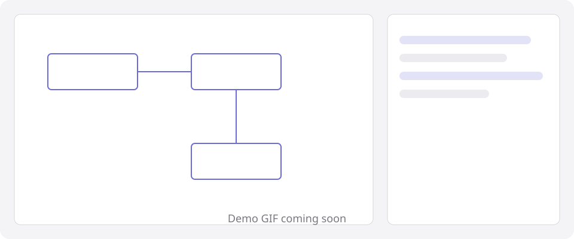
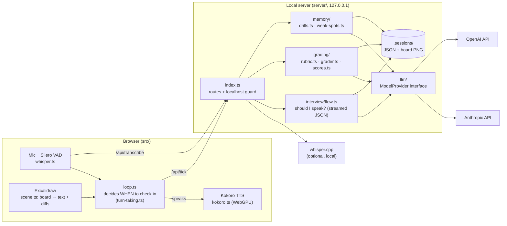

# Mock Interviewer

**Practice system design interviews and recruiter screens out loud, with an AI interviewer that listens, watches your whiteboard, pushes back like a real one, and grades you against a hiring rubric.** Bring your own Anthropic or OpenAI key.



> **A practice tool only.** It is for rehearsing on your own time. Don't use it during a real interview, to get answers fed to you, or anywhere it would break a company's interview rules.

## What it does

- **System design interview** (about 45 minutes): a real Excalidraw whiteboard and an interviewer that hears you think aloud, reads what you draw, asks for the numbers, challenges hand-waves, and cuts in when you go down a wrong path. The Pushback setting (Gentle, Realistic or Tough) sets how hard.
- **Recruiter phone screen** (about 25 minutes): a voice call covering your pitch, experience, motivation, logistics and compensation. Give it your resume (PDF, read in the browser) and a company or job posting, and it researches the company first so the recruiter can talk like it works there.
- **A graded debrief** after every call: a score from 1 to 4 per rubric area, each backed by a timestamped quote, plus a verdict (Strong No to Strong Yes) worked out from those scores.
- **Drills on your weak spots**: from any debrief, about 10 minutes that start right at what went wrong, with their own short debrief. Past calls also show which rubric areas keep scoring low.

## Quickstart

Needs [Bun](https://bun.sh) 1.3 or later, and Chrome or Safari for speech recognition. For other browsers, see local Whisper below.

```bash
git clone https://github.com/SavDont/mock-interviewer.git && cd mock-interviewer
bun install
cp .env.example .env    # then add ANTHROPIC_API_KEY or OPENAI_API_KEY (or paste a key in the app)
bun run dev             # open http://localhost:5173
```

Headphones help: with them on, you can talk over the interviewer to cut it off.

### Local speech recognition (optional, recommended)

The browser's built-in recognizer is fine to start with, but it mangles technical terms, and Chrome sends your audio to Google to transcribe. Local [whisper.cpp](https://github.com/ggml-org/whisper.cpp) is more accurate and keeps audio on your machine. `bun run dev` starts it on its own when it's installed:

```bash
brew install whisper-cpp
mkdir -p models && curl -L -o models/ggml-large-v3-turbo-q5_0.bin \
  https://huggingface.co/ggerganov/whisper.cpp/resolve/main/ggml-large-v3-turbo-q5_0.bin
```

On a slower machine use `ggml-base.en.bin` (148 MB) instead of large-v3-turbo (574 MB).

## Bring your own key

The app calls the model provider directly with your key. There is no hosted backend.

- **Where keys come from:** `ANTHROPIC_API_KEY` or `OPENAI_API_KEY` in `.env`, or the **API key** form on the first screen. For Anthropic, an `ant auth login` session also works. If no key is set, the app says so and won't start a call.
- **Where keys go:** only to their own provider (`api.anthropic.com` or `api.openai.com`). A key typed in the app is sent to the local server, which keeps it in memory only. It is never written to disk and never logged; error messages are scrubbed of anything that looks like a key. "Remember it in this browser" keeps a copy in this browser's localStorage. Leave it unticked if you'd rather paste the key after each restart.
- **Who can reach the server:** it listens on `127.0.0.1` only, and refuses any request not addressed to localhost or coming from another website. That stops other pages you have open from using your key.
- **Picking a provider:** the form switches between them. `LLM_PROVIDER` sets the default, and `ANTHROPIC_MODEL` and `OPENAI_MODEL` pick models. Defaults are `claude-opus-5-5` and `gpt-5.5`.

### What data leaves your machine

| Data                                                            | Goes to                          | When                                                                                   |
| --------------------------------------------------------------- | -------------------------------- | -------------------------------------------------------------------------------------- |
| What you say (as text), whiteboard summaries, interviewer notes | Your model provider              | Every few seconds during a call                                                        |
| Whiteboard screenshots (PNG)                                    | Your model provider              | If "Send whiteboard screenshots" is on (system design)                                 |
| Resume text, company, role or posting link                      | Your model provider              | Recruiter screens, if you provide them                                                 |
| Company and posting lookups                                     | Your model provider's web search | When you click "Research the company"                                                  |
| Your voice (audio)                                              | Google or Apple                  | Only with the browser's built-in recognizer. Local Whisper keeps audio on your machine |
| Nothing (a model download)                                      | Hugging Face                     | First run only: the Kokoro voice model, about 90 to 330 MB, then cached                |

Transcripts, debriefs, resumes and whiteboard images are saved in `.sessions/` on your machine (git-ignored) so you can review past calls. There is no analytics or telemetry.

**Cost:** each check-in is a small, mostly cached request. A 45-minute system design interview on Claude Opus 5.5 costs roughly $1 to $2 with fast mode off, and about twice that with "Faster replies" on. A running estimate is shown during the call.

## How it works



**When to talk** is decided in the browser (`src/loop.ts`), because a few hundred milliseconds matter: after you pause (shorter after a question or a "cool?", longer after "…and the"), when the whiteboard settles, during long drawing stretches, after long silences, and periodically while you monologue, so it can cut in.

**Whether to talk** is the model's call (`server/interview/flow.ts`). Each check returns `{speak, urgency, say, note, end_call}`. Speak and urgency come first in the stream, so the voice starts on the first sentence while the rest is still being written (`decision.ts`). If you start talking while it's thinking, it drops anything not worth interrupting for.

**Cheap long calls:** the system prompt never changes during a session, and the conversation is append-only. Silent checks are committed too, as "(stayed silent)" turns, and the whiteboard is re-sent only when it changes. So each request reuses everything before it from the prompt cache (explicit breakpoints on Anthropic, automatic prefix caching on OpenAI). `tests/flow.test.ts` checks this.

**Providers** implement one small interface (`server/llm/types.ts`): `streamText`, `streamJSON` (structured output), `check`, and optional `research` (web search). Adding a provider is one file.

### Code map

| Module               | What's in it                                                                                   |
| -------------------- | ---------------------------------------------------------------------------------------------- |
| `server/interview/`  | The interview flow, the interviewer prompts (system design and recruiter), and session storage |
| `server/grading/`    | The rubrics as data, the debrief prompts, the grader, and score and verdict parsing            |
| `server/memory/`     | Drills planned from a debrief's weak spots, and recurring weak spots across calls              |
| `server/llm/`        | The provider interface, the Anthropic and OpenAI implementations, and key handling             |
| `server/security.ts` | The localhost-only request guard, and redaction of keys from logs                              |
| `src/`               | The browser app: turn-taking, the whiteboard to text, speech in and out, and the UI            |

## Grading and evals

The rubric lives in `server/grading/rubric.ts` as data. Each area has four anchors, from 1 ("Starts designing with no or wrong requirements") to 4 ("spots the requirement that makes this problem hard"), and the verdict rules are code (`decide(scores)`). The same definitions produce the text the grader reads and check the grader's output:

1. The grader writes a debrief with a Scores table (1 to 4 or n/a per area, each with a timestamped quote) and a verdict.
2. `scores.ts` parses the table and verdict back out.
3. The rules turn the scores into a verdict, and the grader may move it by at most one step, with a stated reason.

`bun run eval` (`evals/grader-consistency.ts`) runs three canned interviews through the real grader several times: a strong, a mixed and a weak URL shortener interview, all synthetic. It checks that the grader is:

- **complete:** every area is scored in every run.
- **rule-consistent:** each verdict is within one step of what the rules give for its own scores.
- **stable:** each area's score varies by at most 1 across runs, and the verdict by at most one step.
- **calibrated:** each verdict falls in the band its fixture expects.
- **ordered:** strong scores above mixed, and mixed above weak.

It makes real API calls, about $1 to $2 for the default 3 fixtures × 3 runs on Claude Opus 5.5, so it isn't part of CI. Run `bun run eval --runs 1 --only mixed` for a quick check.

Unit tests (`bun test`, run in CI) cover:

- the verdict rules and score parsing;
- the streaming decision parser;
- the append-only, cache-friendly conversation, against a fake provider;
- the localhost guard and key redaction;
- key handling;
- turn-taking, whiteboard diffs and transcript cleanup.

## Development

```bash
bun run check     # lint (Biome) + typecheck + unit tests, same as CI
bun run format    # format and fix lint where it can
DEBUG=1 bun run dev   # log each check's timing, tokens and reply
```

Prompt tuning: `server/interview/prompts-system-design.ts` and `prompts-recruiter.ts`. Timing knobs: the top of `src/loop.ts`. See [CONTRIBUTING.md](CONTRIBUTING.md).

## Roadmap

- More interview types: behavioral, hiring manager, coding with a shared editor.
- A problem library (rate limiter, chat, news feed…) with problem-specific checklists for the grader.
- Progress over time: score charts per rubric area across calls.
- Feed recurring weak spots into the next interview, so the interviewer probes them.
- More providers (Gemini, local models through an OpenAI-compatible endpoint) behind the same interface.
- Recruiter-screen fixtures for the grader eval, and evals for the interviewer's turn-taking decisions.
- A packaged desktop app, so there's no terminal step.

## License

[MIT](LICENSE)
